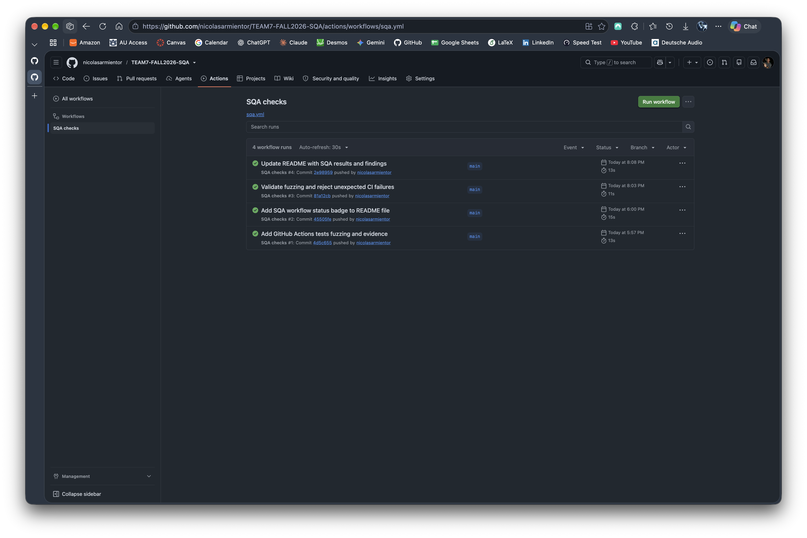
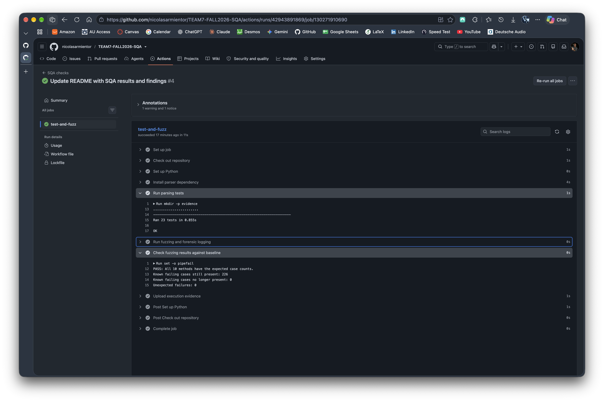
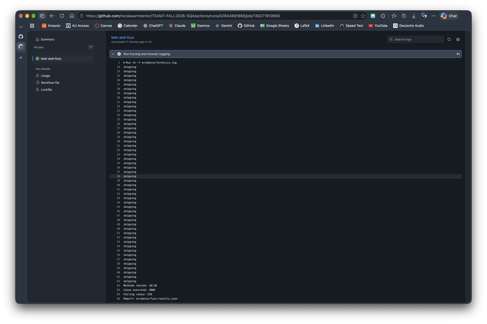
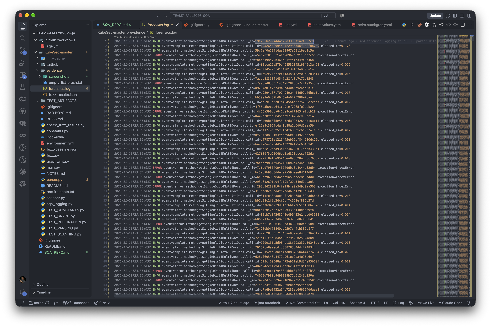

# Software Quality Assurance Project Report

## Team
Team 7 - Nicolas Sarmiento (nzs0102@auburn.edu)

## Project overview

This project has the main goal of implementing software quality assurance techniques and activities performed during the semester to the instructor-given SliKube Python project. The work mainly focuses on ten methods chosen by me in the `parser.py` file.

Part of the additions to this project on my behalf include seeded fuzzing, forensic logging, and continuous integration through the use of GitHub Actions. The fuzzer (`fuzz.py`) executed a total of 1,004 testing cases and takes record of seen software bugs, crashes, and incorrect results from the main code. Then forensic logging (`sqa_logging.py`) was implemented to record the timestamps of execution for all ten methods evaluated. GitHub Actions was responsible of running the parsing tests, executing the fuzzer, and checking and contrasting the results with an available baseline.

Throughout the development of this project, three distinct bugs were identified, represented by 226 cases of the 1,004 tested. These bugs were left unfixed but documented in the same repository.

## Fuzzing approach and results

The `fuzz.py` file makes use of the random module with a selected seed of 5710 to generate consistent and repeatable random inputs. The script checks the following selected methods and presents the following crash count:

|Method|Cases|Failures|
|---|---|---|
|getSingleDict4MultiDocs|104|26|
|getValuesRecursively|100|0|
|getKeyRecursively|100|100|
|getValsFromKey|100|100|
|keyMiner|100|0|
|readYAMLAsStr|100|0|
|checkParseError|100|0|
|loadMultiYAML|100|0|
|checkIfWeirdYAML|100|0|
|checkIfValidHelm|100|0|
|**Total**|**1,004**|**226**|

The 226 failing cases fall into three distinct bug categories:

1. `getSingleDict4MultiDocs` raises an `IndexError` when the document is an empty list.
2. `getKeyRecursively` incorrectly increases the loop depth between neighboring branches.
3. `getValsFromKey` misses nested cases of a matching key.

## Forensic instrumentation

Forensic logging was implemented to the previously mentioned methods tested by the fuzzer. The `sqa_logging.py` file defines the decorators for the functions located in the `parser.py` file. Nine of these methods make use of the `forensic_log` decorator; while, the method `getValuesRecursively` uses the `forensic_generator_log` decorator.

Each call records the starting UTC timestamp and is followed by a respective completion or error case. Exceptions were logged as well.

The events were saved in `evidence/forensics.log`. 

## Continuous integration

GitHub Actions run the workflow defined in `.github/workflows/sqa.yml`. The workflow makes use of the Python version 3.11 and installs `ruamel.yaml==0.17.21`. This workflow executes the 23 parsing tests, then executes `fuzz.py`, and finally goes over the generated report against the `fuzz-baseline.json` file by making use of the `check_fuzz_results.py`.

## Execution evidence

### Continuous integration log

### Parsing tests and baseline validation

The proposed and tested workflow passed a total of 23 parsing tests and reported zero unexpected failures against the compared baseline.

### Fuzzing results

The `fuzz.py` file executed 1,004 test cases across all 10 selected methods. The reported 226 cases that failed, did so as the three bugs documented in [BUGS.md](KubeSec-master/BUGS.md)

### Forensic logging

The log records UTC timestamps, method names, call identifiers, completion times, and exception types. 

### Supporting project files

- [Fuzzing report](KubeSec-master/evidence/fuzz-results.json)
- [Forensic log](KubeSec-master/evidence/forensics.log)
- [Manual crash evidence](KubeSec-master/evidence/empty-list-crash.txt)
- [GitHub Actions runs](https://github.com/nicolasarmientor/TEAM7-FALL2026-SQA/actions)

Each of the workflows presented comes with an `sqa-evidence` structure which contains the following:

- Test output
- Fuzzing output
- Baseline check output
- JSON report
- Forensic log

## Lessons learned

Based on the roadblocks encountered and the results obtained from the pipeline:

- The 23 tests passed, while fuzzing exposed three bugs. Meaning just because a code can run does not mean is it deployment ready.
- The 226 failing cases were limited to these three bugs. Meaning most of the use cases presented may be attributed to just a few errors in the code.
- A fixed random seed made the iterations repeatable and comparable.
- A green CI run with GitHub Actions needed a baseline checker to cross-reference changes and differences.

To me, learning how GitHub Actions operated was arguably the hardest part of the project, it is really important to understand how these workflows work and how to set it up in the .yml file.

## Limitations and remaining bugs

The three documented bugs in this project remain unfixed. The fuzzer successfully detects these; however, the scope of the project is only limited to the selected methods and does not mean there are not more cases failing or bug-free. Methods with zero recorded failures are not proven to be bug-free, so further testing must be implemented to narrow those odds down.

Future work could potentially focus on fixing the actual bugs and broaden the inputs to run additional tests.